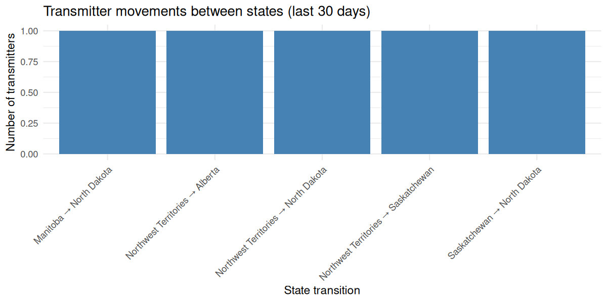
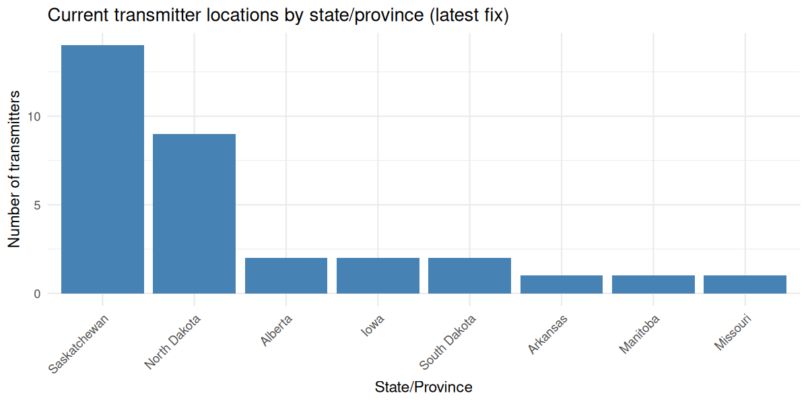

# Weekly Mallard Migration Status

**Window:** 2026-10-07 to 2026-11-06 (UTC)
**Transmitters reporting:** 32  |  **GPS fixes:** 19,676

**This week:** Of 28 transmitters reporting this week, 2 moved 150+ km south and none moved north.

## Migration outlook (next 7 days)

**Next 7 days: about 8 of the 20 tracked birds not yet in the Lower Mississippi Valley expected to make a big move south (150 km or more).** Fewer than 1 expected to arrive in the Lower Mississippi Valley.

<iframe src="data/fig_outlook.html" width="100%" height="350" style="border:0" loading="lazy"></iframe>

**% = chance at least one tracked bird makes a big move that night.** Red bars: expected number of big moves south (150 km or more) each night. Green bars: expected number of birds arriving in the Lower Mississippi Valley. Days 4–7 (hatched) are lower confidence: wind forecasts beyond 3 days are less reliable.

_Group forecast for the tracked birds only, from weather forecasts and past fall movements; each bird is scored from its last known area. Updated Nov 6, 6:32 AM CT._

## Latitude by day

<iframe src="data/fig_latitude.html" width="100%" height="460" style="border:0" loading="lazy"></iframe>

_Dashed lines: mean latitude of all tracked birds in past years. Orange: 2026 mean. Grey: each active bird this year. Click a legend entry to hide or show it._

## Where are they? (this week vs. past years)

<iframe src="data/fig_states.html" width="100%" height="440" style="border:0" loading="lazy"></iframe>

_Transmitters by state/province in ISO week 45 of each year (top 10 by this year's count). 2026 in red. Click a year in the legend to hide or show it._

## Current state/province distribution (latest fix per transmitter)

- Saskatchewan: 53.1% (n=17)
- North Dakota: 25% (n=8)
- Alberta: 9.4% (n=3)
- South Dakota: 6.2% (n=2)
- Iowa: 3.1% (n=1)
- Manitoba: 3.1% (n=1)

## Migration status (by transmitter, last 30 days)

- Local: 23 (71.9%)
- Transitional: 1 (3.1%)
- Migrating: 8 (25%)

## Notes

State/province percentages reflect the **current location of each transmitter**, its most recent GPS fix in the 30-day window, rather than the total number of GPS fixes collected. Migration status compares each transmitter's first and last fix in the window: **Migrating** is 150+ km with at least 1° of latitude change in either direction, **Transitional** is 60+ km without that, and **Local** is everything else. 8 transmitters are classed as migrating (8 south), 1 transitional and 23 local.

## Top movers (net displacement, last 30 days)

| Bird ID | Net displacement (km) | Direction | Lat change (°) | Current location |
|:--|--:|:--|--:|:--|
| 377547 | 1,670 | south | -14.36 | North Dakota |
| 377542 | 1,256 | south | -9.73 | Saskatchewan |
| 377538 | 918 | south | -7.25 | North Dakota |
| 227229 | 847 | south | -6.92 | Iowa |
| 377524 | 411 | south | -3.44 | North Dakota |

## State-to-state movements (last 30 days)

## Current transmitter location distribution

## Transmitter location distribution over time (last 30 days)

[Interactive bar chart](data/state_counts_slider.html)

