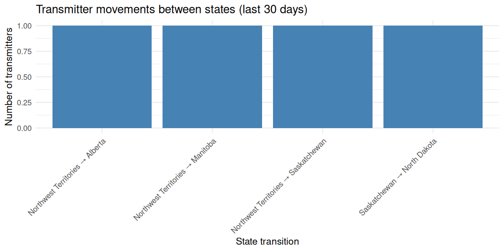

# Weekly Mallard Migration Status

**Window:** 2026-09-24 to 2026-10-24 (UTC)
**Transmitters reporting:** 32  |  **GPS fixes:** 20,287

## Current state/province distribution (latest fix per transmitter)

- Saskatchewan: 56.2% (n=18)
- North Dakota: 21.9% (n=7)
- Alberta: 9.4% (n=3)
- Manitoba: 6.2% (n=2)
- South Dakota: 6.2% (n=2)

## Migration status (by transmitter)

- Local: 26 (81.2%)
- Transitional: 6 (18.8%)

## Notes

State/province percentages reflect the **current location of each transmitter** based on its most recent GPS fix within the last 7 days, rather than the total number of GPS fixes collected. Most transmitters continue to show **local late-winter movements** within primary wintering areas. A subset of birds are showing **transitional behavior** (larger net displacement without strong latitudinal gain), and the **leading edge of spring migration** is evident among birds with substantial northward movement over the last week.

## Leading movement this week (net displacement)

- 377542: **1,028 km** net, lat change **-7.88°**, current admin area **Saskatchewan**
- 377547: **  902 km** net, lat change **-7.94°**, current admin area **Saskatchewan**
- 377538: **  837 km** net, lat change **-6.63°**, current admin area **North Dakota**

## State-to-state movements (last 7 days)

## Current transmitter location distribution

## Transmitter location distribution over time (last 30 days)

[Interactive bar chart](data/state_counts_slider.html)

