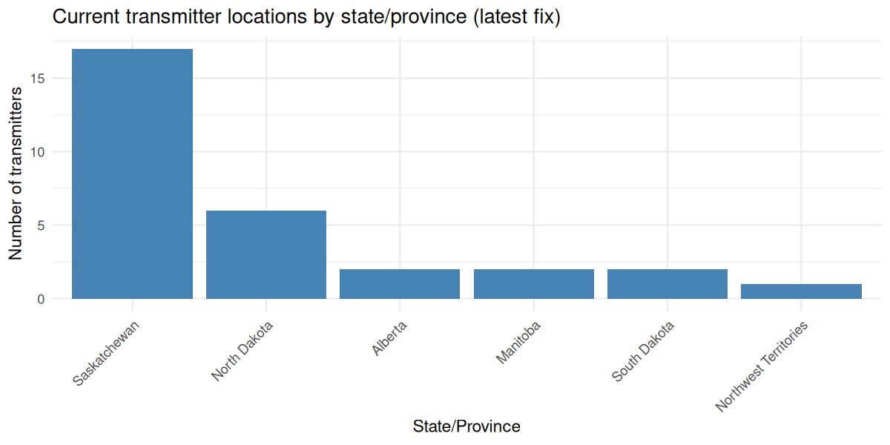

# Weekly Mallard Migration Status

**Window:** 2026-09-15 to 2026-10-15 (UTC)
**Transmitters reporting:** 30  |  **GPS fixes:** 19,238

## Current state/province distribution (latest fix per transmitter)

- Saskatchewan: 56.7% (n=17)
- North Dakota: 20% (n=6)
- Alberta: 6.7% (n=2)
- Manitoba: 6.7% (n=2)
- South Dakota: 6.7% (n=2)
- Northwest Territories: 3.3% (n=1)

## Migration status (by transmitter)

- Local: 27 (90%)
- Transitional: 3 (10%)

## Notes

State/province percentages reflect the **current location of each transmitter** based on its most recent GPS fix within the last 7 days, rather than the total number of GPS fixes collected. Most transmitters continue to show **local late-winter movements** within primary wintering areas. A subset of birds are showing **transitional behavior** (larger net displacement without strong latitudinal gain), and the **leading edge of spring migration** is evident among birds with substantial northward movement over the last week.

## Leading movement this week (net displacement)

- 377545: **172 km** net, lat change **-1.37°**, current admin area **North Dakota**
- 247435: **104 km** net, lat change **-0.88°**, current admin area **Saskatchewan**
- 236638: ** 78 km** net, lat change **-0.37°**, current admin area **North Dakota**

## Current transmitter location distribution

## Transmitter location distribution over time (last 30 days)

[Interactive bar chart](data/state_counts_slider.html)

